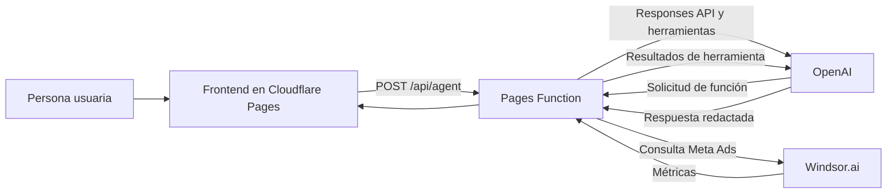

# Arquitectura técnica

## 1. Alcance de esta copia

El ZIP permite revisar el prototipo y su integración prevista. La interfaz es general y usa datos ficticios para sus gráficas. El backend contiene una Pages Function para enviar preguntas a OpenAI y, mediante herramientas del agente, consultar Meta Ads por Windsor.ai.

No se incluyen claves, tokens, contraseñas, IDs reales de cuentas publicitarias, bases de datos de producción ni datos personales. Sin credenciales y despliegue de la función, el chat no puede consultar datos reales.

## 2. Componentes y tecnologías

| Capa | Archivo/servicio | Tecnología | Responsabilidad |
|---|---|---|---|
| Frontend | `index.html` | HTML, CSS y JavaScript | Renderiza el dashboard, conserva el filtro de periodo/zona, muestra datos de ejemplo y envía mensajes al backend. |
| Hosting | Cloudflare Pages | Hosting estático | Publica `index.html` y sirve la ruta de Pages Functions. |
| Backend | `functions/api/agent.js` | Cloudflare Pages Functions, JavaScript | Valida la petición, llama a OpenAI, ejecuta las herramientas de consulta y devuelve la respuesta. |
| Modelo | OpenAI Responses API (`/v1/responses`) | API HTTPS | Redacta respuestas y decide si debe invocar una herramienta disponible. Modelo configurable; valor por defecto `gpt-4.1-mini`. |
| Adaptador de anuncios | Windsor.ai (`/facebook`) | API HTTPS | Recupera métricas de Meta Ads de la cuenta configurada. |
| Datos para gráficos | `DATA` dentro de `index.html` | Arreglos JavaScript | Datos sintéticos. No son la fuente de las respuestas del chat. |

No hay base de datos, servidor Python, FastAPI, Uvicorn, SQLite, Google Drive, OAuth de Drive ni escenario de Make en esta versión. El código usa `fetch` y APIs nativas del runtime de Cloudflare; el ZIP no contiene un proceso de compilación separado ni dependencias de Node declaradas.

## 3. Diagrama de comunicación



Las claves permanecen en variables del servidor Cloudflare. El navegador nunca debe recibirlas.

## 4. Flujo de una pregunta

1. La persona escribe en el chat de `index.html` y selecciona 7 o 30 días y una zona.
2. JavaScript mantiene el historial en memoria durante la sesión del navegador. Al enviar, recorta el historial a los últimos 10 mensajes y cada contenido a 1,500 caracteres.
3. El navegador hace una petición del mismo origen a `POST /api/agent` con `messages`, `period` y `branch`.
4. `onRequestPost` valida el JSON y las variables de entorno. El periodo aceptado es 7 o 30; si no es 7, el servidor usa 30. La zona debe pertenecer a las opciones configuradas.
5. La Pages Function envía el mensaje y las instrucciones del agente a OpenAI Responses API. `tool_choice` está en `auto`; el ciclo permite hasta cuatro turnos de herramienta.
6. OpenAI puede invocar una de estas herramientas:
   - `get_campaign_performance`: resumen agregado para rendimiento general, campañas, anuncios, zonas o categorías.
   - `get_campaign_detail`: busca una campaña, conjunto o anuncio por texto.
7. La función consulta Windsor.ai, filtra el periodo y, si corresponde, aplica el filtro de zona; agrega inversión, leads, clics e impresiones y calcula CPL/CTR.
8. Los resultados vuelven a OpenAI como salida de herramienta. El modelo redacta la respuesta y la Pages Function entrega `{ "reply": "..." }` al navegador.

El agente está configurado como solo lectura: puede consultar e interpretar resultados y sugerir revisiones; no modifica campañas.

## 5. Contratos principales

### Petición del frontend

```json
{
  "messages": [{ "role": "user", "content": "¿Qué campañas generaron más leads?" }],
  "period": 7,
  "branch": "Todas"
}
```

`period` es `7` o `30`. `branch` acepta `Todas`, `Zona Norte`, `Zona Centro`, `Zona Sur` o `Zona Este` en este prototipo.

### Respuesta correcta

```json
{ "reply": "Respuesta redactada a partir de los resultados consultados." }
```

### Errores

La función devuelve errores HTTP para JSON inválido o mensaje faltante (`400`), credenciales/configuración ausentes (`503`) y fallos de proveedor o ejecución (`502`).

## 6. Petición a Windsor.ai

La función usa `https://connectors.windsor.ai/facebook` y envía:

- `api_key`: `WINDSOR_API_KEY`.
- `select_accounts`: `WINDSOR_ACCOUNT`.
- `date_preset`: `last_7d` o `last_30d`.
- `fields`: `date`, `campaign`, `campaign_id`, `spend`, `impressions`, `clicks`, `actions_lead`, `ad_name`, `adset_name`, `ad_id`.

La respuesta se normaliza desde un arreglo o las propiedades `data`/`rows`. Luego se agregan métricas por campaña, anuncio y zona; CPL se calcula como inversión/leads, CTR como clics/impresiones.

## 7. Datos ficticios y adaptación a otros clientes

Las gráficas y tablas del dashboard usan `DATA.daily`, `DATA.ads` y `DATA.monthly` en `index.html`; sus campañas, IDs y métricas son inventados para la demostración. No representan cuentas reales y no alimentan las respuestas del chat.

El adaptador server-side trae datos de la cuenta configurada. La detección de zona está codificada para cuatro nombres de ejemplo (`ZONA NORTE`, `ZONA CENTRO`, `ZONA SUR`, `ZONA ESTE`) y la agrupación de categoría usa nombres de ejemplo (`CATEGORIA A` a `CATEGORIA D`). El equipo deberá adaptar estas reglas y las opciones del frontend al modelo de cada cliente.

## 8. Variables de entorno

Configurar en Cloudflare Pages → Settings → Variables and Secrets:

| Variable | Tipo | Uso |
|---|---|---|
| `OPENAI_API_KEY` | Secret cifrado | Autentica la llamada a OpenAI API. |
| `WINDSOR_API_KEY` | Secret cifrado | Autentica la consulta a Windsor.ai. |
| `WINDSOR_ACCOUNT` | Variable del servidor | Identifica la cuenta publicitaria en Windsor.ai. |
| `OPENAI_MODEL` | Opcional | Modelo para Responses API; por defecto `gpt-4.1-mini`. |

No pegar claves en HTML, repositorios o chats. Ninguna de estas variables tiene valores reales en el ZIP.

## 9. Seguridad, límites y pendientes

- **Autenticación:** la ruta `POST /api/agent` no implementa login ni autorización. Si se habilitan las claves en un sitio público, cualquier visitante podría consumir llamadas y consultar métricas. Proteger la ruta antes de producción.
- **Permisos:** el código solo consulta métricas; no realiza cambios en Ads Manager.
- **Fuente actual:** Meta Ads mediante Windsor.ai. Google Ads, TikTok, LinkedIn, CRM y otras plataformas requieren nuevos adaptadores.
- **Benchmarks del sector:** no hay búsqueda web ni base de benchmarks; no responderá promedios de mercado con evidencia conectada.
- **Taxonomía:** zonas/categorías de ejemplo deben parametrizarse por cuenta/cliente.
- **Persistencia:** no hay base de datos; el chat vive en memoria del navegador y no se guarda en el servidor.
- **Validación real:** esta copia no permite validar llamadas sin credenciales y despliegue. El contenido de pantalla es ficticio.

## 10. Despliegue de Pages Functions

La estructura requerida es `functions/api/agent.js`, que publica `POST /api/agent`. Para un proyecto de Pages creado por Direct Upload, desplegar con Wrangler desde la raíz del ZIP:

```bash
npx wrangler login
npx wrangler pages deploy . --project-name NOMBRE_DEL_PROYECTO --branch main
```

Ajustar el nombre del proyecto y rama al entorno. El panel de carga de archivos estáticos no compila Pages Functions. Después del despliegue, configurar las variables del apartado 8 y probar el endpoint con acceso controlado.
