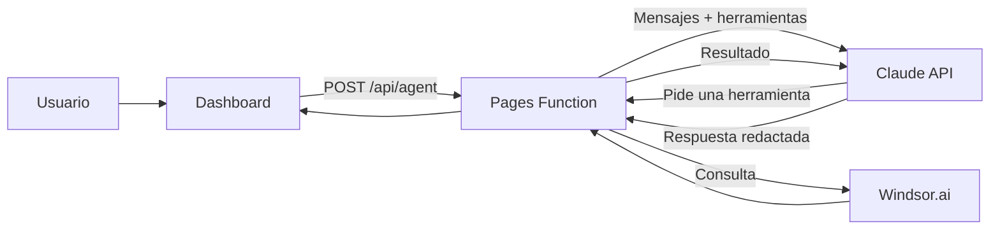

# Arquitectura técnica

## 1. Componentes

| Capa | Archivo/servicio | Responsabilidad |
|---|---|---|
| Frontend | `public/index.html` | Dashboard, filtros de periodo/zona y chat. Las gráficas aún usan datos ficticios embebidos. |
| Hosting | Cloudflare Pages | Publica `public/` y ejecuta `functions/`. |
| Endpoint | `functions/api/agent.js` | Valida la petición, llama al agente y traduce errores. |
| Agente | `functions/_lib/agent.js` | Llama a Claude con el SDK oficial `@anthropic-ai/sdk` y le da dos herramientas de consulta. |
| Cálculos | `functions/_lib/metrics.js` | Totales, CPL, CTR y agrupaciones. Los números los calcula el código, nunca el modelo. |
| Datos | `functions/_lib/windsor.js` | Métricas de Meta Ads vía Windsor.ai, o datos de demostración con `DEMO_MODE=1`. |
| Reglas de negocio | `functions/_lib/config.js` | Periodos, zonas y categorías. |

## 2. Flujo de una pregunta



1. El usuario escribe en el chat; el navegador envía los últimos 10 mensajes, el periodo (7 o 30 días) y la zona.
2. El endpoint valida todo y llama a `runAgent`.
3. El *tool runner* del SDK de Anthropic maneja el ciclo: Claude decide qué herramienta usar, el servidor la ejecuta y le devuelve el resultado, hasta que Claude redacta la respuesta (máximo 6 vueltas).
4. Los datos de Windsor se descargan una sola vez por pregunta, aunque Claude use varias herramientas.

Herramientas del agente:

- `get_campaign_performance(branch)`: totales, campañas, anuncios principales, comparación de zonas y categorías por zona.
- `get_campaign_detail(branch, query)`: busca campañas, conjuntos o anuncios por nombre.

El agente es de **solo lectura**: no puede modificar campañas.

## 3. Modelo de Claude

| Ajuste | Valor por defecto | Variable para cambiarlo |
|---|---|---|
| Modelo | `claude-opus-5-5` | `ANTHROPIC_MODEL` (p. ej. `claude-sonnet-5-5` o `claude-haiku-5-5`, más baratos) |
| Esfuerzo de razonamiento | `medium` | `ANTHROPIC_EFFORT` (`low`, `medium`, `high`) |

Si el modelo rechaza una pregunta por sus filtros de seguridad, la API la reintenta sola con un modelo alternativo (`fallbacks: "default"`).

## 4. Contrato del endpoint

Petición:

```json
{
  "messages": [{ "role": "user", "content": "¿Qué campañas generaron más leads?" }],
  "period": 7,
  "branch": "Todas"
}
```

Respuesta: `{ "reply": "...", "demo": false }`.

Errores: `400` petición inválida · `429` demasiadas consultas · `502` error de Claude o Windsor · `503` faltan variables (incluye `missing` con la lista).

## 5. Windsor.ai

`GET https://connectors.windsor.ai/facebook` con `api_key`, `select_accounts`, `date_preset` (`last_7d` / `last_30d`) y los campos `date, campaign, campaign_id, spend, impressions, clicks, actions_lead, ad_name, adset_name, ad_id`.

## 6. Zonas y categorías

Se detectan buscando el texto configurado en `config.js` (p. ej. `ZONA NORTE`, `CATEGORIA A`) dentro del nombre de campaña, conjunto o anuncio. Hay que ajustarlas a la nomenclatura real de cada cliente.

## 7. Desarrollo y pruebas

- `npm run dev`: servidor local en `http://localhost:8788` con las variables de `.dev.vars`.
- `npm test`: pruebas de cálculos y del endpoint completo, con una API de Claude simulada (no gasta créditos).

## 8. Variables de entorno

Configurar en Cloudflare → Pages → Settings → Variables and Secrets (y en `.dev.vars` para local):

| Variable | Tipo | Uso |
|---|---|---|
| `ANTHROPIC_API_KEY` | Secreto | Clave de la API de Claude (platform.claude.com). |
| `WINDSOR_API_KEY` | Secreto | Clave de Windsor.ai. |
| `WINDSOR_ACCOUNT` | Variable | Cuenta publicitaria en Windsor.ai. |
| `ANTHROPIC_MODEL` | Opcional | Modelo de Claude. |
| `ANTHROPIC_EFFORT` | Opcional | Nivel de esfuerzo. |
| `DEMO_MODE` | Opcional | `1` = datos de demostración en vez de Windsor. |

Nunca escribas claves en el código ni las subas al repositorio (`.dev.vars` está en `.gitignore`).

## 9. Seguridad y pendientes

- **Login (prioritario):** `/api/agent` no tiene autenticación. Antes de publicar con claves reales hay que protegerlo (plan: Cloudflare Access, con acceso por cliente).
- **Multi-cliente:** hoy hay una sola cuenta de Windsor y una sola configuración de zonas. Para enviarlo a clientes, cada uno debe ver solo sus datos.
- **Dashboard con datos reales:** las gráficas usan datos ficticios embebidos en `index.html`.
- **Más fuentes:** Google Ads, TikTok y CRM requieren nuevos adaptadores.
- **Periodos:** solo 7 y 30 días.
